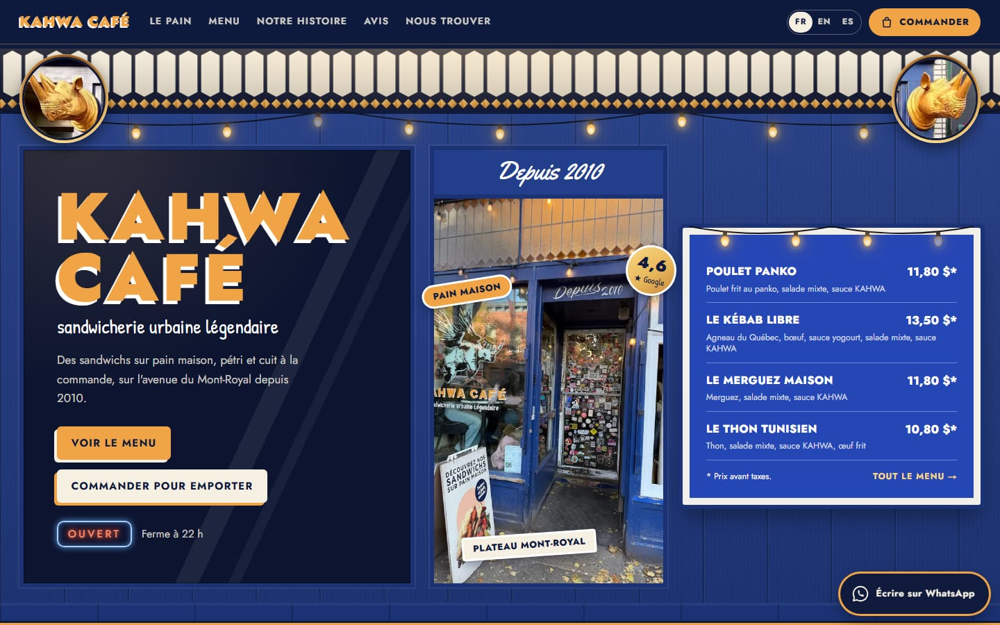
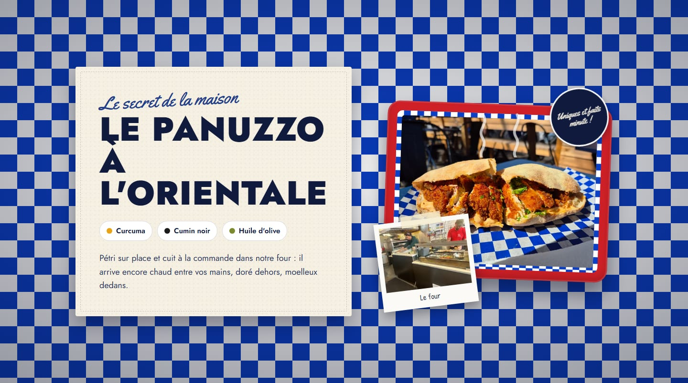
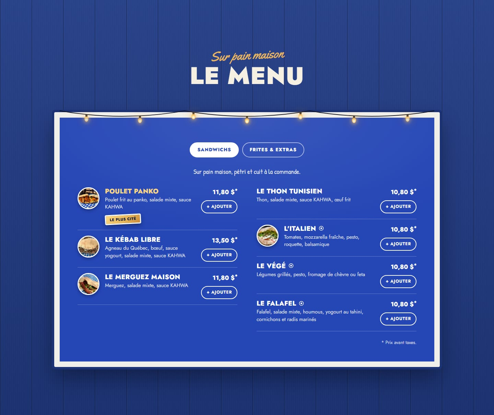
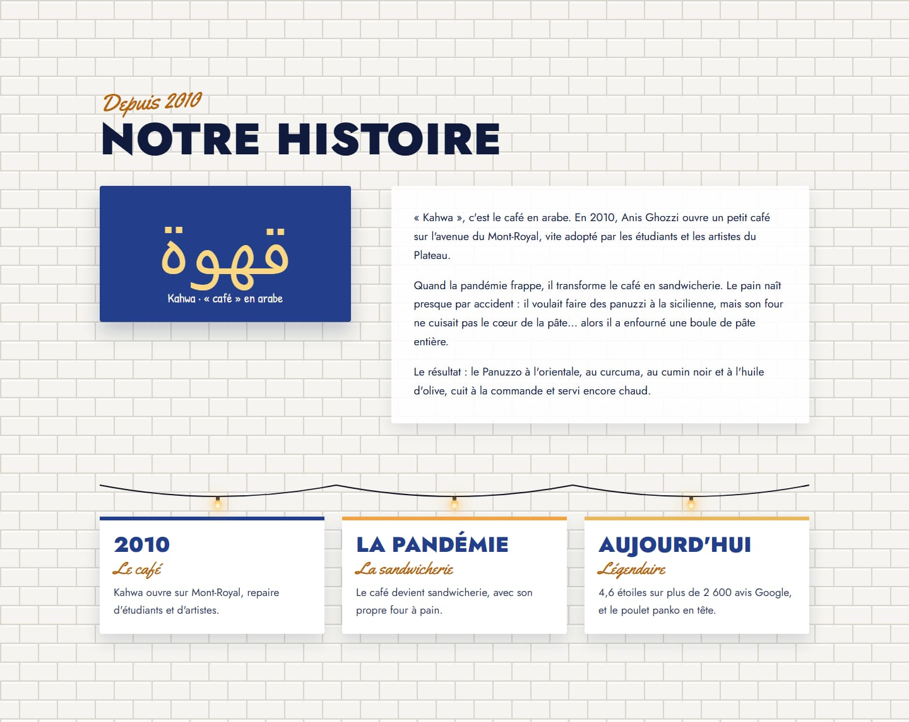
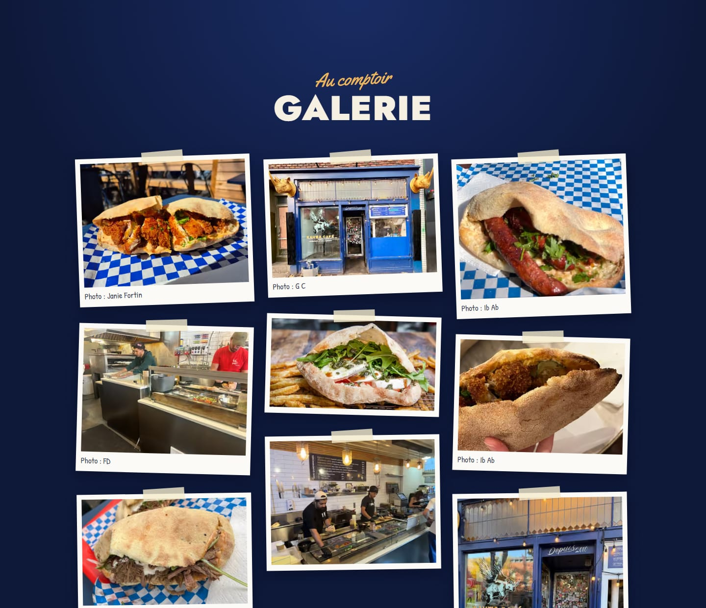
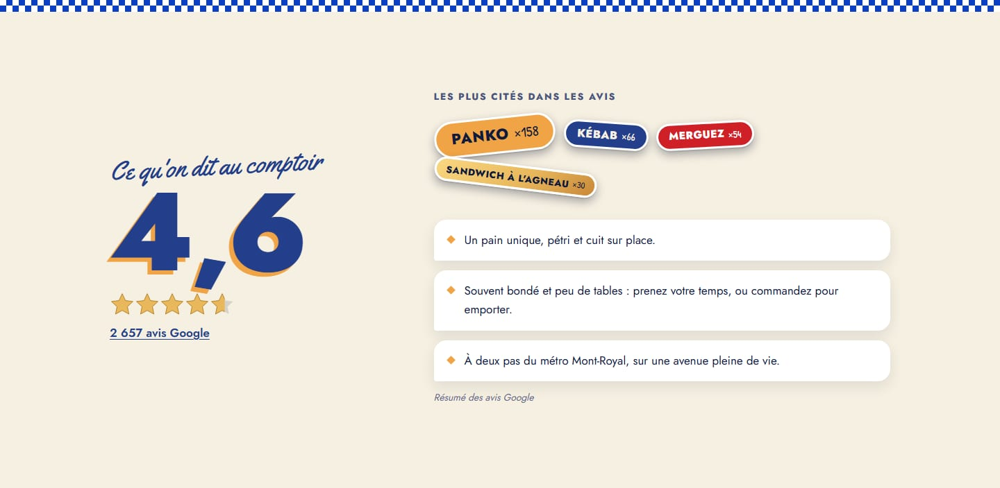
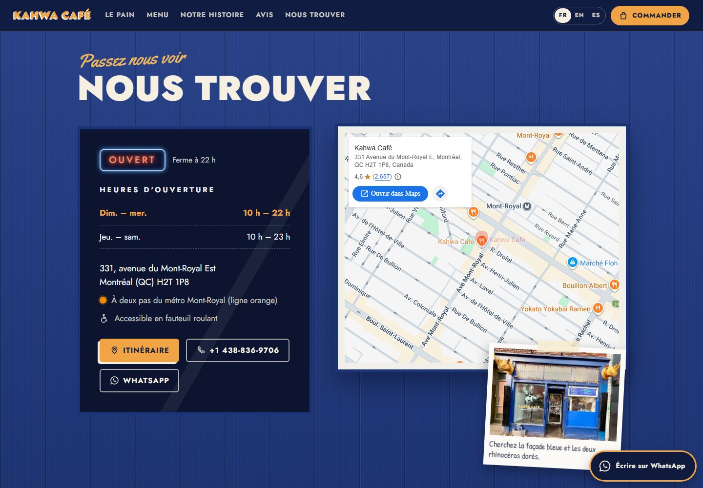
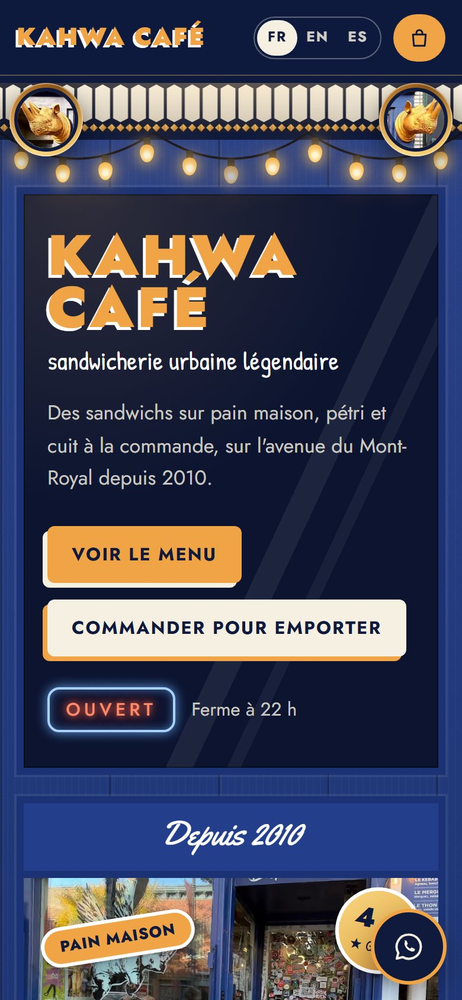
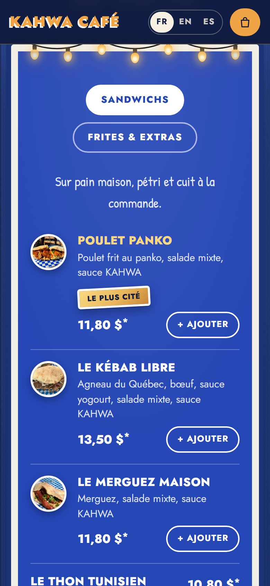
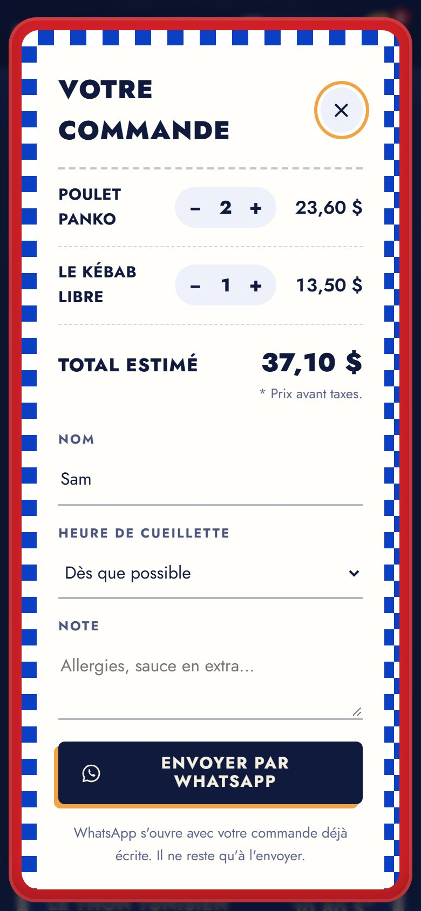

<div align="center">


# Kahwa Café · Website demo

**Sandwicherie urbaine légendaire · Montréal, depuis 2010.**
A mock-up of Kahwa Café's website: menu with prices, pickup orders via WhatsApp, live opening hours and three languages.


[Español](README.md) · **English**

</div>

> [!NOTE]
> **This is a demo mock-up, not Kahwa Café's official website.** It was built from public information (Google Maps, local press) to show the owner. It displays a visible notice and is not indexed by Google (`noindex`). Before going live as the real site, the data marked as pending must be confirmed.



## Overview

|              |                                                                                          |
| ------------ | ---------------------------------------------------------------------------------------- |
| What it is   | A one-page website for Kahwa Café, 331 avenue du Mont-Royal Est, Montréal                |
| Tier         | **Premium** (switches to Standard or Basic with one line)                                |
| Languages    | French (default), English and Spanish, with a switcher                                   |
| Currency     | Canadian dollar (CAD), prices before tax                                                 |
| Orders       | Pickup orders via WhatsApp: no payment gateway, no database, no backend                  |
| Design       | Made for this shop: taken from its photos (blue storefront, stained glass, menu board, checkered paper) |
| Stack        | Next.js 15 (App Router), React 19, TypeScript, framer-motion                             |
| Hosting      | Vercel. Static page, no environment variables                                            |
| Code         | Commented in **Spanish and English**, marking what can and cannot be changed             |

## Screenshots

<table>
  <tr>
    <td width="50%"></td>
    <td width="50%"></td>
  </tr>
  <tr>
    <td></td>
    <td></td>
  </tr>
  <tr>
    <td></td>
    <td></td>
  </tr>
</table>

On mobile (390 px): hero, menu and the order on the red tray.

<p align="center">
  
  &nbsp;
  
  &nbsp;
  
</p>

## What each section does

**Header**

- Logo styled like the shop-window sign, links to each section (on wide screens), FR · EN · ES switcher and a **Commander** button with the item count.

**Hero: the storefront**

- The real storefront in three panels: the shop window with the sign and buttons, the sticker-covered door (real photo) and the menu board with four sandwiches and their prices.
- On top, the amber-diamond stained glass, the string lights and the two golden rhinos (cropped from the storefront photo).
- An **OUVERT / FERMÉ** neon sign computed in Montréal time, not the visitor's: "Ferme à 22 h", "Ouvre demain à 10 h".

**Ribbon**

- Moving lines from the sandwich board and menu: *Pain maison · Cuit à la commande · Sauce KAHWA · Agneau du Québec · Depuis 2010*.

**Le pain**

- The Panuzzo à l'orientale and its three ingredients on the blue checkered paper it is served on, with the sandwich on the red tray, animated steam, a photo of the oven and the "Uniques et faits minute !" badge.

**The menu: the board**

- The blue board with a white frame and light bulbs, in two columns: name, ingredients, price and the "* Prix avant taxes" note.
- *Sandwichs* and *Frites & extras* tabs, dish photos, a vegetarian icon and a "Le plus cité" label on the item most mentioned on Google.
- A **+ Ajouter** button that turns into a counter (− 2 +).

**Pickup order (WhatsApp)**

- Built on the "red tray" with checkered paper: items, quantities, estimated total, name, pickup time (every 15 minutes until closing, in Montréal time) and a note.
- Sending opens WhatsApp with the message already written. Nothing is charged on the site and no data is stored.

```text
Bonjour Kahwa Café ! J'aimerais commander pour emporter :

• 2 × Poulet Panko — 23,60 $
• 1 × Le Kébab Libre — 13,50 $

Total estimé : 37,10 $
Nom : Sam
Cueillette : Dès que possible
```

**Story: "Depuis 2010"**

- Over the shop's white subway tile: the word قهوة (*kahwa*, "coffee" in Arabic), the story of the shop and its bread, and three moments hanging from the string lights.

**Gallery: "Au comptoir"**

- Nine taped photos with their author's name handwritten.

**Reviews**

- 4.6 rating with stars, a link to the 2,657 Google reviews, the most mentioned topics as stickers (bigger with more mentions) and unnamed summaries (no made-up quotes).

**Getting there: "Nous trouver"**

- Hours styled like the door's vinyl lettering, with today highlighted; address, Mont-Royal metro, accessibility, directions/call/WhatsApp buttons, a Google map (no API key) and a storefront postcard: "Cherchez la façade bleue et les deux rhinocéros dorés".

**Languages**

- The whole page switches to French, English or Spanish: texts, days, times (22 h / 10 p.m. / 22:00) and prices (11,80 $ / $11.80). The choice is remembered by the browser.

## Tiers

The same website is sold at three levels. It is switched with `gama` in `src/data/cafe.config.ts`; sections that are not included hide themselves.

| Includes                                          | Basic | Standard | Premium |
| ------------------------------------------------- | :---: | :------: | :-----: |
| Hero, menu, hours, map and contact                |   ✓   |    ✓     |    ✓    |
| Story, gallery and reviews                        |   –   |    ✓     |    ✓    |
| Floating WhatsApp button and scroll animations    |   –   |    ✓     |    ✓    |
| Menu with tabs and photos                         |   –   |    –     |    ✓    |
| Pickup orders via WhatsApp                        |   –   |    –     |    ✓    |
| Table booking via WhatsApp\*                      |   –   |    –     |    ✓    |
| Language switcher, promotions and extra animations |   –   |    –     |    ✓    |

\* Turned off in this demo (`funciones: { reserva: false }`): the shop has few tables. Turn it on with `reserva: true`.

## How to edit the content

Regular maintenance does not touch the design: almost everything lives in **`src/data/cafe.config.ts`**, and every block explains in Spanish and English how to change it.

| I want to change…                     | File                        | Where                                                  |
| ------------------------------------- | --------------------------- | ------------------------------------------------------ |
| A price, a name or the ingredients    | `src/data/cafe.config.ts`   | `carta` → `platos` → `precio`, `nombre`, `descripcion` |
| Add or remove an item                 | `src/data/cafe.config.ts`   | `carta` → `platos` (copy a block with a new `id`)      |
| Opening hours                         | `src/data/cafe.config.ts`   | `horario.franjas` (0 = Sunday … 6 = Saturday)          |
| Phone or WhatsApp                     | `src/data/cafe.config.ts`   | `contacto.telefono`, `contacto.whatsapp`               |
| Address and map                       | `src/data/cafe.config.ts`   | `contacto.direccion`, `ciudad`, `lat`, `lng`           |
| Rating and number of reviews          | `src/data/cafe.config.ts`   | `resenas`                                              |
| The story                             | `src/data/cafe.config.ts`   | `historia.parrafos`, `historia.hitos`                  |
| A photo                               | `public/img/`               | Replace the file keeping the same name                 |
| Sticker, ribbon and heading lines     | `src/estilo/textos.ts`      | `COPY`                                                 |
| A color across the site               | `src/estilo/estilo.css`     | The `:root` block at the top                           |
| The default language                  | `src/data/cafe.config.ts`   | `idiomaBase`                                           |
| The tier                              | `src/data/cafe.config.ts`   | `gama`                                                 |
| Turn bookings on                      | `src/data/cafe.config.ts`   | `funciones: { reserva: true }`                         |
| Go from demo to the real site         | `src/data/cafe.config.ts`   | `demo: false` and `seo.url` with the domain            |

Editing rules:

- Keep quotes and commas. Multi-language texts look like this: `{ fr: "…", en: "…", es: "…" }`.
- Prices with a decimal point and no symbol: `11.8` shows as 11,80 $.
- 24-hour times: `"22:00"`. A closed day: delete its line.
- Every item needs a unique `id` with no spaces. An item without `precio` is shown but cannot be ordered.
- When done, `npm run build` must finish without errors (or push and Vercel checks it).

## What can and cannot be changed

Every file states its level on its first line, and every code comment is written in Spanish (`ES:`) and English (`EN:`).

| Label                            | Meaning                                                                               | Files                                                                                          |
| -------------------------------- | ------------------------------------------------------------------------------------- | ---------------------------------------------------------------------------------------------- |
| `[EDITABLE]`                     | Change freely: texts, prices, hours, contact, photos, colors                          | `src/data/cafe.config.ts`, `src/estilo/textos.ts`, `public/img/`, `public/marca/`, `:root` in `estilo.css` |
| `[CON CUIDADO · EDIT WITH CARE]` | Design. Can be changed with React and CSS knowledge; a mistake breaks the look, not the data | The rest of `src/estilo/`                                                                  |
| `[NO TOCAR · DO NOT EDIT]`       | Engine: tiers, languages, hours, cart, WhatsApp, SEO and security                     | `src/motor/`, `src/app/`, `src/estilo/index.ts`, `next.config.js`, `tsconfig.json`, `package.json` |

## Structure

```text
demo-cafe/
├── src/
│   ├── data/
│   │   └── cafe.config.ts     [EDITABLE]        Café data: menu, prices, hours, contact, photos, story
│   ├── estilo/                                  Kahwa skin: the design made for this shop
│   │   ├── textos.ts          [EDITABLE]        Sticker, ribbon and heading lines (fr/en/es)
│   │   ├── estilo.css         [EDIT WITH CARE]  Styles; the :root colors are [EDITABLE]
│   │   ├── fuentes.ts         [EDIT WITH CARE]  Jost, Yellowtail and Patrick Hand
│   │   ├── decor.tsx          [EDIT WITH CARE]  Stained glass, lights, stickers, medallions, neon, stars, icons
│   │   ├── Pagina.tsx         [EDIT WITH CARE]  Section order
│   │   ├── index.ts           [DO NOT EDIT]     Contract between the skin and the engine
│   │   └── secciones/         [EDIT WITH CARE]  Header, storefront, ribbon, bread, menu, story,
│   │                                            gallery, reviews, visit, footer, order tray
│   ├── motor/                 [DO NOT EDIT]     Tiers, languages, hours, cart, WhatsApp, map, SEO
│   └── app/                   [DO NOT EDIT]     Next.js layout and page
├── public/
│   ├── img/                   [EDITABLE]        Photos (same name = replaced without touching code)
│   └── marca/icono.svg        [EDITABLE]        Browser tab icon
├── docs/
│   ├── DISEÑO.md                                Style sheet: where every color, font and detail comes from
│   ├── INFO-EXTRAIDA.md                         Source of every data point and open items with the owner
│   ├── fotos.json                               Origin, size and author of every photo
│   └── capturas/                                Images used in this README
├── next.config.js             [DO NOT EDIT]     Security headers and images
└── package.json               [DO NOT EDIT]     Dependencies and scripts
```

## Getting started

Requirements: Node.js 18.18 or later (20+ recommended).

```bash
git clone https://github.com/alesstron/demo-cafe.git
cd demo-cafe
npm install
npm run dev
```

The site runs at [http://localhost:3000](http://localhost:3000).

| Command             | What it does                  |
| ------------------- | ----------------------------- |
| `npm run dev`       | Development server            |
| `npm run build`     | Production build              |
| `npm run start`     | Serves the build              |
| `npm run typecheck` | Checks the TypeScript types   |

## Deploying to Vercel

1. On [vercel.com](https://vercel.com): **Add New → Project** and import `alesstron/demo-cafe`.
2. Vercel detects Next.js. No environment variables are needed: **Deploy**.
3. Every push to `main` publishes a new version automatically.
4. Once there is a final domain: set `seo.url` in `cafe.config.ts` (link previews) and, for the real site, `demo: false`.

## Maintenance (every 6 months)

- [ ] Check hours, menu and prices with the shop.
- [ ] Update the Google Maps rating and review count.
- [ ] Swap photos if there are new or seasonal items.
- [ ] `npm outdated`, `npm update` (minor versions) and `npm audit`.
- [ ] `npm run build` without errors and a quick check on a phone.
- [ ] Push to `main`: Vercel publishes it.

Major version upgrades (for example Next.js 16) are best done with a developer.

## Design

The full style sheet is in [`docs/DISEÑO.md`](docs/DISEÑO.md) (Spanish). The palette was measured on the shop's photos and text contrast is checked (WCAG AA).

| Color             | Hex       | Where it comes from         |
| ----------------- | --------- | --------------------------- |
|  Bleu façade   | `#233F8C` | The storefront paint        |
|  Bleu nuit     | `#0F1A3D` | The cornice shadow          |
|  Bleu ardoise  | `#2546B5` | The menu board              |
|  Bleu carreau  | `#0B3FC4` | The checkered paper         |
|  Or rhino      | `#E9B85C` | The golden rhinos           |
|  Orange        | `#F0A445` | The shop-window sign        |
|  Rouge plateau | `#CF2027` | The red tray                |
|  Crème         | `#F6F0E2` | The napkin                  |

Typography: **Jost** (like the Futura-style sign), **Yellowtail** (the "Depuis 2010" script) and **Patrick Hand** (the handwriting on the window).

## Quality and security

- **Tested:** TypeScript with no errors, production build, 375 px with no horizontal scroll, the full order flow (WhatsApp message, name validation, total), the three tiers and the three languages.
- **Performance:** static page (170 kB of initial JavaScript), AVIF/WebP photos through `next/image`, self-hosted fonts.
- **Accessibility:** visible focus, labelled fields, alt text on photos, checked contrast and support for "reduce motion".
- **Security:** `Content-Security-Policy`, `Strict-Transport-Security`, `X-Frame-Options: DENY`, `X-Content-Type-Options: nosniff`, `Referrer-Policy` and `Permissions-Policy` headers; form text is sanitized; no API keys, no environment variables and no backend.
- **SEO:** title, description, Open Graph and Google structured data (address, coordinates, hours). The demo is `noindex`.

## Status and open items with the owner

- [x] Storefront, menu with real prices, WhatsApp orders, story, gallery, reviews, map and three languages
- [x] Code commented in Spanish and English
- [ ] Confirm the WhatsApp number (currently the shop's public phone)
- [ ] Prices for fries, duo, trio and extras
- [ ] The shop's own photos (the current ones are customer photos from Google Maps)
- [ ] Facebook and Instagram links
- [ ] Owner review of the story text
- [ ] Final domain, `seo.url` and `demo: false`

## Credits and sources

- **Data:** public Google Maps listing (November 2026), the storefront menu board, the review on [Tastet](https://tastet.ca/critiques/kahwa-cafe-un-hommage-au-sandwich/) and [The Main](https://www.themain.com/fr/montreal/restaurant/kahwa-cafe). Details in [`docs/INFO-EXTRAIDA.md`](docs/INFO-EXTRAIDA.md) (Spanish).
- **Photos:** customers on Google Maps: Janie Fortin, Ib Ab, G C, FD and David Korenberg. Two photos have no visible author. Each one is credited in the gallery.
- **Typefaces:** Jost, Yellowtail and Patrick Hand (Google Fonts, SIL Open Font License).

## License

Private project. Code © 2026 alesstron. Kahwa Café's name, logo, photos and data belong to their owners and authors.
