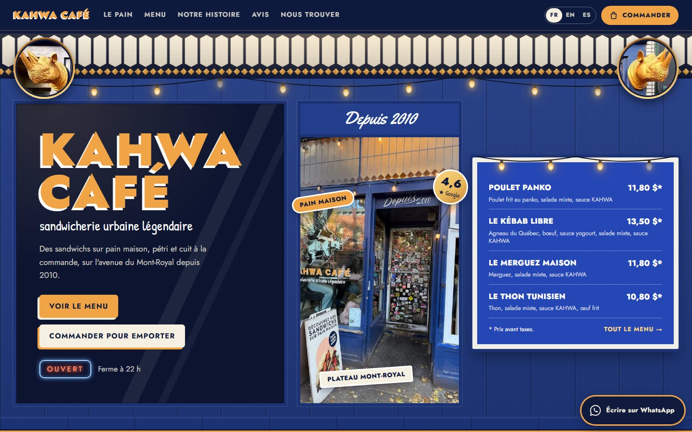
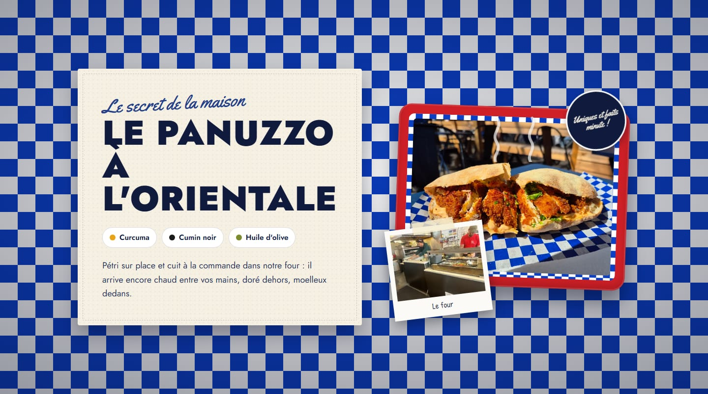
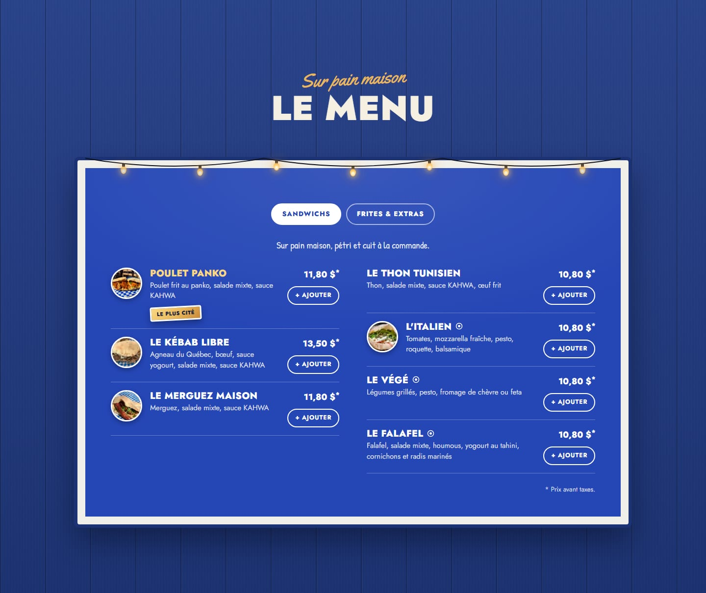
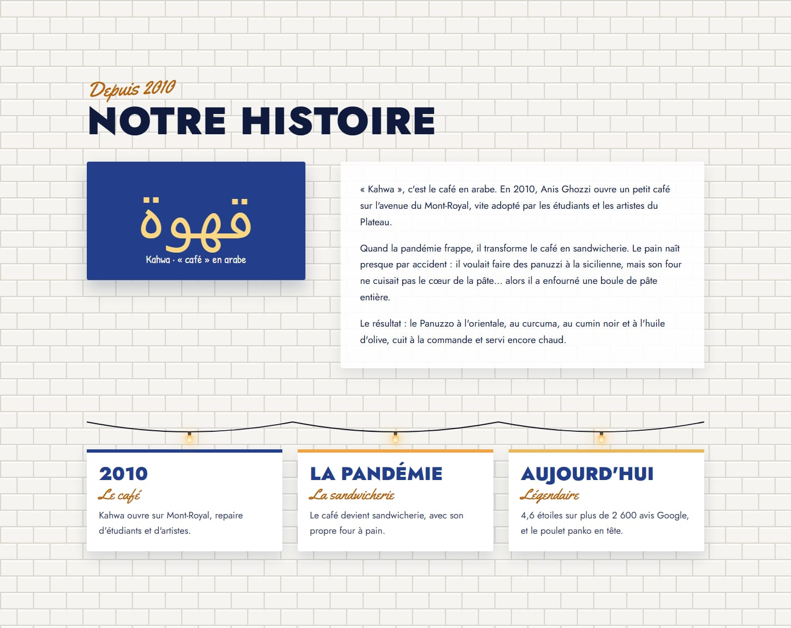
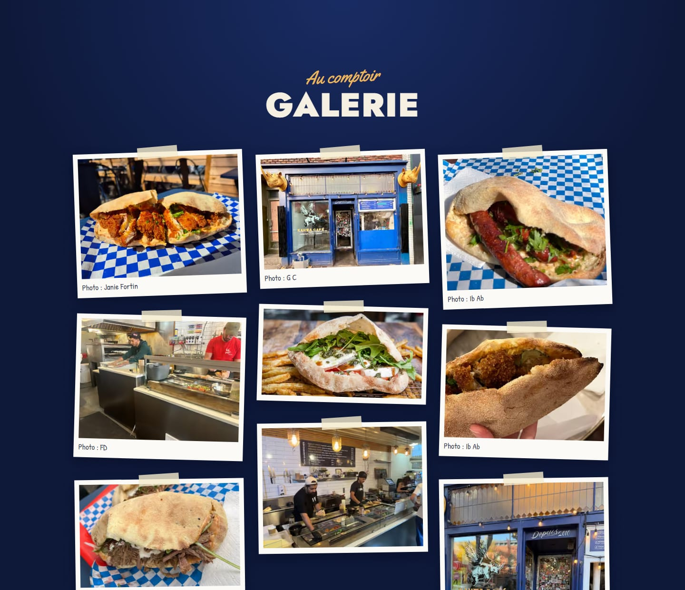
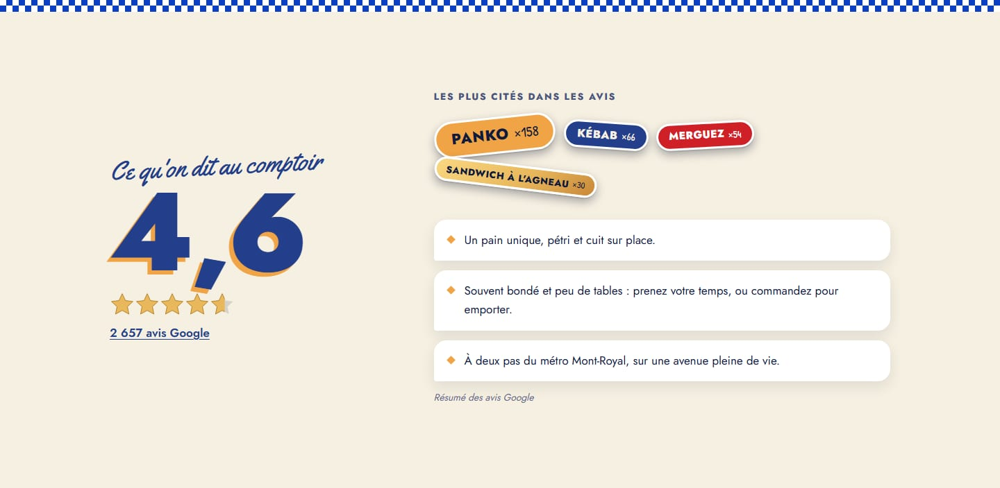
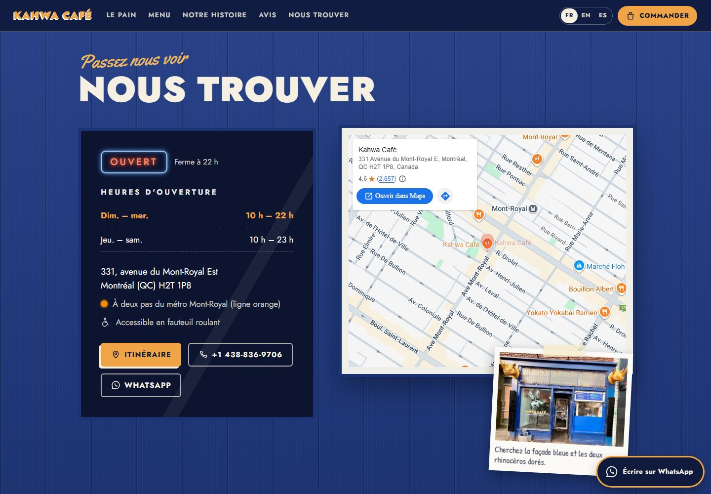
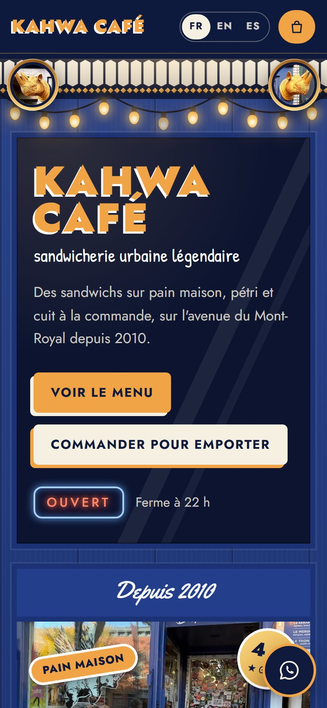
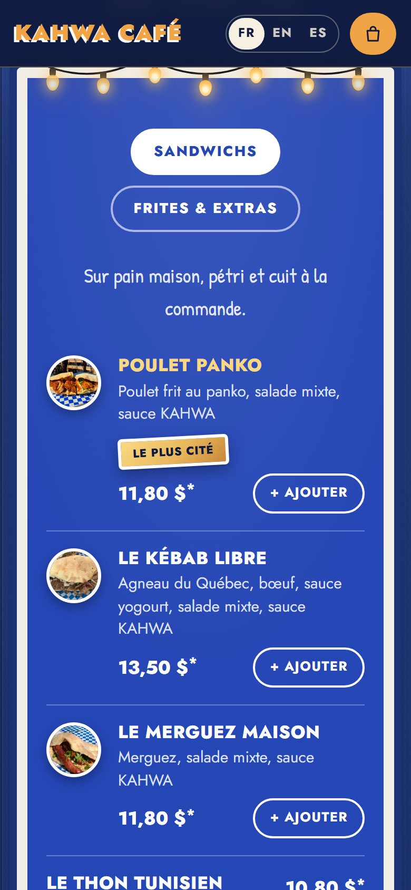
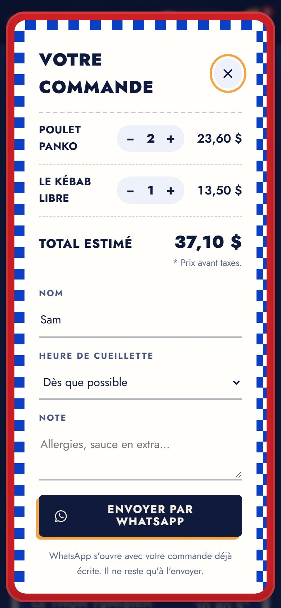

<div align="center">


# Kahwa Café · Web demo

**Sandwicherie urbaine légendaire · Montréal, depuis 2010.**
Maqueta de la web de Kahwa Café: carta con precios, pedidos para llevar por WhatsApp, horario en vivo y tres idiomas.


**Español** · [English](README.en.md)

</div>

> [!NOTE]
> **Maqueta de demostración, no es la web oficial de Kahwa Café.** Se preparó con información pública (Google Maps, prensa local) para enseñársela al dueño. Muestra un aviso visible y no se indexa en Google (`noindex`). Antes de publicarla como web real hay que confirmar los datos marcados como pendientes.



## Resumen

|                 |                                                                                         |
| --------------- | --------------------------------------------------------------------------------------- |
| Qué es          | Web de una sola página para Kahwa Café, 331 avenue du Mont-Royal Est, Montréal          |
| Gama            | **Premium** (se cambia a Estándar o Básica con una línea)                               |
| Idiomas         | Francés (por defecto), inglés y español, con selector                                   |
| Moneda          | Dólar canadiense (CAD), precios antes de impuestos                                      |
| Pedidos         | Para llevar, por WhatsApp: sin pasarela de pago, sin base de datos y sin backend        |
| Diseño          | Propio de este local: sale de sus fotos (fachada azul, vitral, pizarra, papel de cuadros) |
| Tecnología      | Next.js 15 (App Router), React 19, TypeScript, framer-motion                            |
| Alojamiento     | Vercel. Página estática, sin variables de entorno                                       |
| Código          | Comentado en **español e inglés**, con lo que se puede y no se puede tocar              |

## Capturas

<table>
  <tr>
    <td width="50%"></td>
    <td width="50%"></td>
  </tr>
  <tr>
    <td></td>
    <td></td>
  </tr>
  <tr>
    <td></td>
    <td></td>
  </tr>
</table>

En el móvil (390 px): portada, carta y pedido en la bandeja roja.

<p align="center">
  
  &nbsp;
  
  &nbsp;
  
</p>

## Qué hace cada sección

**Cabecera**

- Logotipo como el letrero de la vitrina, enlaces a cada sección (en pantallas anchas), selector FR · EN · ES y botón **Commander** con el número de artículos.

**Portada: la fachada**

- La fachada real en tres paneles: la vitrina con el letrero y los botones, la puerta con pegatinas (foto real) y la pizarra con cuatro sándwiches y sus precios.
- Arriba, el vitral con rombos ámbar, la guirnalda de bombillas y los dos rinocerontes dorados (recortes de la foto de la fachada).
- Rótulo de neón **OUVERT / FERMÉ** calculado con la hora de Montréal, no la del visitante: "Ferme à 22 h", "Ouvre demain à 10 h".

**Cinta**

- Frases del caballete y la pizarra en movimiento: *Pain maison · Cuit à la commande · Sauce KAHWA · Agneau du Québec · Depuis 2010*.

**Le pain**

- El Panuzzo à l'orientale y sus tres ingredientes sobre el papel de cuadros azules en que se sirve, con el sándwich en la bandeja roja, vapor animado, foto del horno y el sello "Uniques et faits minute !".

**La carta: la pizarra**

- La pizarra azul con marco blanco y bombillas, en dos columnas: nombre, ingredientes, precio y nota "* Prix avant taxes".
- Pestañas *Sandwichs* y *Frites & extras*, fotos de los platos, icono de vegetariano y etiqueta "Le plus cité" en el más mencionado en Google.
- Botón **+ Ajouter** que se convierte en contador (− 2 +).

**Pedido para llevar (WhatsApp)**

- Se arma en la "bandeja roja" con papel de cuadros: platos, cantidades, total estimado, nombre, hora de recogida (cada 15 min hasta el cierre, en hora de Montréal) y nota.
- Al enviar se abre WhatsApp con el mensaje ya escrito. No se cobra nada en la web y no se guardan datos.

```text
Bonjour Kahwa Café ! J'aimerais commander pour emporter :

• 2 × Poulet Panko — 23,60 $
• 1 × Le Kébab Libre — 13,50 $

Total estimé : 37,10 $
Nom : Sam
Cueillette : Dès que possible
```

**Historia: "Depuis 2010"**

- Sobre el azulejo blanco del interior: la palabra قهوة (*kahwa*, "café" en árabe), la historia del local y del pan, y tres momentos colgados de la guirnalda.

**Galería: "Au comptoir"**

- Nueve fotos con cinta adhesiva y el nombre de su autor escrito a mano.

**Opiniones**

- Nota 4,6 con estrellas, enlace a las 2 657 opiniones de Google, los temas más citados como pegatinas (más grandes cuantas más menciones) y resúmenes sin nombre (no son citas inventadas).

**Cómo llegar: "Nous trouver"**

- Horario como el vinilo de la puerta, con el día de hoy resaltado; dirección, metro Mont-Royal, accesibilidad, botones de itinerario, llamada y WhatsApp, mapa de Google (sin API key) y postal de la fachada: "Cherchez la façade bleue et les deux rhinocéros dorés".

**Idiomas**

- Toda la página cambia a francés, inglés o español: textos, días, horas (22 h / 10 p.m. / 22:00) y precios (11,80 $ / $11.80). La elección se recuerda en el navegador.

## Gamas

La misma web se vende en tres niveles. Se cambia con `gama` en `src/data/cafe.config.ts`; las secciones que no entran se ocultan solas.

| Incluye                                            | Básica | Estándar | Premium |
| -------------------------------------------------- | :----: | :------: | :-----: |
| Portada, carta, horario, mapa y contacto           |   ✓    |    ✓     |    ✓    |
| Historia, galería y opiniones                      |   –    |    ✓     |    ✓    |
| Botón flotante de WhatsApp y animaciones al bajar  |   –    |    ✓     |    ✓    |
| Carta con pestañas y fotos                         |   –    |    –     |    ✓    |
| Pedido para llevar por WhatsApp                    |   –    |    –     |    ✓    |
| Reserva de mesa por WhatsApp\*                     |   –    |    –     |    ✓    |
| Selector de idioma, promociones y animaciones extra |   –    |    –     |    ✓    |

\* Desactivada en esta demo (`funciones: { reserva: false }`): el local tiene pocas mesas. Se activa con `reserva: true`.

## Cómo editar el contenido

El mantenimiento normal no toca el diseño: casi todo está en **`src/data/cafe.config.ts`**, y cada bloque explica en español e inglés cómo cambiarlo.

| Quiero cambiar…                         | Archivo                     | Dónde                                                   |
| --------------------------------------- | --------------------------- | ------------------------------------------------------- |
| Un precio, un nombre o los ingredientes | `src/data/cafe.config.ts`   | `carta` → `platos` → `precio`, `nombre`, `descripcion`  |
| Añadir o quitar un plato                | `src/data/cafe.config.ts`   | `carta` → `platos` (copiar un bloque con un `id` nuevo) |
| El horario                              | `src/data/cafe.config.ts`   | `horario.franjas` (0 = domingo … 6 = sábado)            |
| Teléfono o WhatsApp                     | `src/data/cafe.config.ts`   | `contacto.telefono`, `contacto.whatsapp`                |
| Dirección y mapa                        | `src/data/cafe.config.ts`   | `contacto.direccion`, `ciudad`, `lat`, `lng`            |
| Nota y número de opiniones              | `src/data/cafe.config.ts`   | `resenas`                                               |
| La historia                             | `src/data/cafe.config.ts`   | `historia.parrafos`, `historia.hitos`                   |
| Una foto                                | `public/img/`               | Reemplazar el archivo con el mismo nombre               |
| Frases de pegatinas, cinta y títulos    | `src/estilo/textos.ts`      | `COPY`                                                  |
| Un color de toda la web                 | `src/estilo/estilo.css`     | Bloque `:root` del principio                            |
| El idioma por defecto                   | `src/data/cafe.config.ts`   | `idiomaBase`                                            |
| La gama                                 | `src/data/cafe.config.ts`   | `gama`                                                  |
| Activar las reservas                    | `src/data/cafe.config.ts`   | `funciones: { reserva: true }`                          |
| Pasar de demo a web real                | `src/data/cafe.config.ts`   | `demo: false` y `seo.url` con el dominio                |

Reglas al editar:

- Respeta comillas y comas. Los textos en varios idiomas van así: `{ fr: "…", en: "…", es: "…" }`.
- Precios con punto decimal y sin símbolo: `11.8` se muestra como 11,80 $.
- Horas en formato de 24 h: `"22:00"`. Un día cerrado: borra su línea.
- Cada plato necesita un `id` único sin espacios. Un plato sin `precio` se muestra, pero no se puede pedir.
- Al terminar, `npm run build` debe acabar sin errores (o haz push y Vercel lo comprueba).

## Qué se puede tocar y qué no

Cada archivo dice su nivel en la primera línea, y todos los comentarios del código están en español (`ES:`) y en inglés (`EN:`).

| Etiqueta                         | Significado                                                                              | Archivos                                                                                       |
| -------------------------------- | ---------------------------------------------------------------------------------------- | ---------------------------------------------------------------------------------------------- |
| `[EDITABLE]`                     | Se cambia sin miedo: textos, precios, horario, contacto, fotos, colores                  | `src/data/cafe.config.ts`, `src/estilo/textos.ts`, `public/img/`, `public/marca/`, `:root` de `estilo.css` |
| `[CON CUIDADO · EDIT WITH CARE]` | Diseño. Se puede cambiar sabiendo React y CSS; un error rompe el aspecto, no los datos    | El resto de `src/estilo/`                                                                      |
| `[NO TOCAR · DO NOT EDIT]`       | Motor: gamas, idiomas, horario, carrito, WhatsApp, SEO y seguridad                        | `src/motor/`, `src/app/`, `src/estilo/index.ts`, `next.config.js`, `tsconfig.json`, `package.json` |

## Estructura

```text
demo-cafe/
├── src/
│   ├── data/
│   │   └── cafe.config.ts     [EDITABLE]     Datos del café: carta, precios, horario, contacto, fotos, historia
│   ├── estilo/                               Piel de Kahwa: el diseño propio de este local
│   │   ├── textos.ts          [EDITABLE]     Frases de pegatinas, cinta y títulos (fr/en/es)
│   │   ├── estilo.css         [CON CUIDADO]  Estilos; los colores de :root son [EDITABLE]
│   │   ├── fuentes.ts         [CON CUIDADO]  Jost, Yellowtail y Patrick Hand
│   │   ├── decor.tsx          [CON CUIDADO]  Vitral, guirnalda, pegatinas, medallones, neón, estrellas, iconos
│   │   ├── Pagina.tsx         [CON CUIDADO]  Orden de las secciones
│   │   ├── index.ts           [NO TOCAR]     Contrato entre la piel y el motor
│   │   └── secciones/         [CON CUIDADO]  Cabecera, Fachada, Cinta, Pan, Carta, Historia,
│   │                                         Galeria, Opiniones, Visita, Pie, Bandeja (pedido)
│   ├── motor/                 [NO TOCAR]     Gamas, idiomas, horario, carrito, WhatsApp, mapa, SEO
│   └── app/                   [NO TOCAR]     Layout y página de Next.js
├── public/
│   ├── img/                   [EDITABLE]     Fotos (mismo nombre = se reemplaza sin tocar código)
│   └── marca/icono.svg        [EDITABLE]     Icono de la pestaña
├── docs/
│   ├── DISEÑO.md                             Ficha de estilo: de dónde sale cada color, letra y detalle
│   ├── INFO-EXTRAIDA.md                      Fuente de cada dato y pendientes con el dueño
│   ├── fotos.json                            Origen, medidas y autor de cada foto
│   └── capturas/                             Imágenes de este README
├── next.config.js             [NO TOCAR]     Cabeceras de seguridad e imágenes
└── package.json               [NO TOCAR]     Dependencias y comandos
```

## Empezar

Requisitos: Node.js 18.18 o superior (recomendado 20 o más).

```bash
git clone https://github.com/alesstron/demo-cafe.git
cd demo-cafe
npm install
npm run dev
```

La web queda en [http://localhost:3000](http://localhost:3000).

| Comando             | Qué hace                                 |
| ------------------- | ---------------------------------------- |
| `npm run dev`       | Servidor de desarrollo                   |
| `npm run build`     | Compilación de producción                |
| `npm run start`     | Sirve la compilación                     |
| `npm run typecheck` | Comprueba los tipos de TypeScript        |

## Despliegue en Vercel

1. En [vercel.com](https://vercel.com): **Add New → Project** e importar `alesstron/demo-cafe`.
2. Vercel detecta Next.js. No hace falta ninguna variable de entorno: **Deploy**.
3. Cada push a `main` publica una versión nueva sola.
4. Con el dominio definitivo: poner `seo.url` en `cafe.config.ts` (vistas previas al compartir el enlace) y, para la web real, `demo: false`.

## Mantenimiento (cada 6 meses)

- [ ] Revisar con el local horario, carta y precios.
- [ ] Actualizar la nota y el número de opiniones de Google Maps.
- [ ] Cambiar fotos si hay platos nuevos o de temporada.
- [ ] `npm outdated` y `npm update` (versiones menores) y `npm audit`.
- [ ] `npm run build` sin errores y revisión rápida en el móvil.
- [ ] Push a `main`: Vercel publica solo.

Los saltos de versión mayor (por ejemplo Next.js 16) conviene hacerlos con un desarrollador.

## Diseño

La ficha completa está en [`docs/DISEÑO.md`](docs/DISEÑO.md). La paleta se midió en las fotos del local y el contraste del texto está comprobado (WCAG AA).

| Color             | Hex       | De dónde sale                    |
| ----------------- | --------- | -------------------------------- |
|  Bleu façade   | `#233F8C` | La pintura de la fachada         |
|  Bleu nuit     | `#0F1A3D` | La sombra de la cornisa          |
|  Bleu ardoise  | `#2546B5` | La pizarra de la carta           |
|  Bleu carreau  | `#0B3FC4` | El papel de cuadros              |
|  Or rhino      | `#E9B85C` | Los rinocerontes dorados         |
|  Orange        | `#F0A445` | El letrero de la vitrina         |
|  Rouge plateau | `#CF2027` | La bandeja roja                  |
|  Crème         | `#F6F0E2` | La servilleta                    |

Tipografía: **Jost** (como el letrero tipo Futura), **Yellowtail** (la caligrafía de "Depuis 2010") y **Patrick Hand** (la letra a mano de la vitrina).

## Calidad y seguridad

- **Probado:** TypeScript sin errores, compilación de producción, 375 px sin scroll horizontal, pedido completo (mensaje de WhatsApp, validación del nombre, total), las tres gamas y los tres idiomas.
- **Rendimiento:** página estática (170 kB de JavaScript inicial), fotos en AVIF/WebP con `next/image`, fuentes alojadas en el propio dominio.
- **Accesibilidad:** foco visible, etiquetas en los campos, texto alternativo en las fotos, contraste comprobado y respeto de "reducir movimiento".
- **Seguridad:** cabeceras `Content-Security-Policy`, `Strict-Transport-Security`, `X-Frame-Options: DENY`, `X-Content-Type-Options: nosniff`, `Referrer-Policy` y `Permissions-Policy`; el texto de los formularios se sanea; sin API keys, sin variables de entorno y sin backend.
- **SEO:** título, descripción, Open Graph y datos estructurados de Google (dirección, coordenadas, horario). La demo lleva `noindex`.

## Estado y pendientes con el dueño

- [x] Fachada, carta con precios reales, pedido por WhatsApp, historia, galería, opiniones, mapa y tres idiomas
- [x] Código comentado en español e inglés
- [ ] Confirmar el número de WhatsApp (hoy es el teléfono público del local)
- [ ] Precios de frites, duo, trio y extras
- [ ] Fotos propias del local (las actuales son de clientes en Google Maps)
- [ ] Enlaces de Facebook e Instagram
- [ ] Revisar con el dueño el texto de la historia
- [ ] Dominio definitivo, `seo.url` y `demo: false`

## Créditos y fuentes

- **Datos:** ficha pública de Google Maps (noviembre de 2026), pizarra de la fachada, reseña de [Tastet](https://tastet.ca/critiques/kahwa-cafe-un-hommage-au-sandwich/) y [The Main](https://www.themain.com/fr/montreal/restaurant/kahwa-cafe). Detalle en [`docs/INFO-EXTRAIDA.md`](docs/INFO-EXTRAIDA.md).
- **Fotos:** clientes en Google Maps: Janie Fortin, Ib Ab, G C, FD y David Korenberg. Dos fotos sin autor visible. Cada una lleva su crédito en la galería.
- **Tipografías:** Jost, Yellowtail y Patrick Hand (Google Fonts, licencia SIL Open Font License).

## Licencia

Proyecto privado. Código © 2026 alesstron. La marca, el logotipo, las fotos y los datos de Kahwa Café pertenecen a sus dueños y autores.
